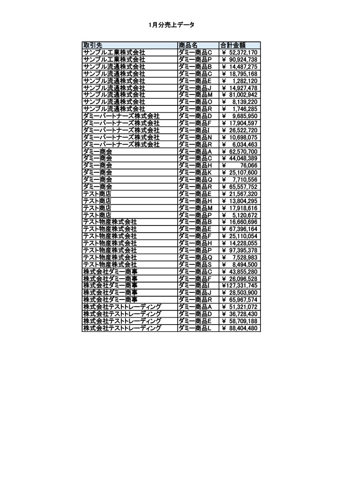
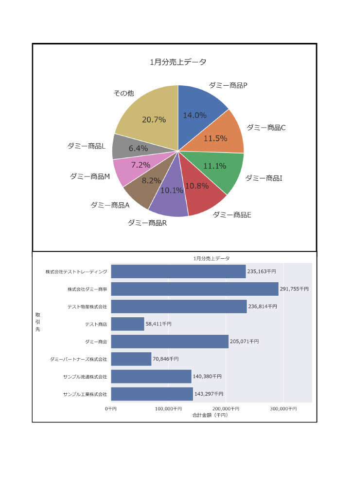

# python-monthly-sales-automation
## 概要
- Excelで記入した売上データを月ごとに集計し、PDFとして出力する自動化ツールです。
- 当プロジェクト内で使用しているExcelデータはClaudeにて作成したダミーデータです。


## 目的
- 毎月の売上データ集計業務を想定し、当プロジェクトの作成を始めました。
- VBAが使用できない環境下での自動化ツール開発にPythonを使用しました。


## 機能
Excelの売上データを読み込み、以下のファイルを自動出力します。
|出力ファイル|形式|出力先|
|:---|:---|:---|
|月次売上データ（画像添付済み）|.xlsx|data/processed|
|棒/円グラフ画像|.png|outputs/plot|
|月次売上データ（Excel内のデータをpdf化）|.pdf|outputs/pdf|

- **複数シート対応**：シートごとに上記ファイルを出力し、シート名がファイル名となります
- **フォルダ自動生成**：出力フォルダの格納フォルダがない場合、実行時にフォルダが自動生成されます
- **進捗表示**：各処理の完了をエラー内容をターミナルにて表示します

## 出力例
### 1月分の売上データの場合（ダミーデータです）
|1月売上データ|1月売上グラフ|
|:---:|:--:|
|||


## 実行方法
**前提として、以下の環境が必要です。**
- Windows / Microsoft Excel インストール済み / Python 3.12

### 手順
1. 下記のコマンドを実行し、ライブラリをインストール
  ```
  powershell pip install -r rqruirements.txt
  ```
  
2. data/raw内に加工前のExcelファイル（.xlsx）を配置
### 入力Excelの形式
必須列：取引先 / 商品名 / 単価 / 数量 / 合計金額（列名は `Columns` クラスの定義）

3. **プロジェクト直下**で実行
  ```
  powershell python main.py
  ```
4. 出力を確認（data/processed・outputs/plot・outputs/pdf）

> [!WARNING]
> プロジェクト直下以外で実行すると`RuntimeError`になります。

## 使用技術
|区分|ライブラリ|バージョン|用途|
|:---|:---|:---|:---|
|言語|python|3.12.10|ツール開発|
|テスト用フレームワーク|pytest|9.1.1|テストコード実装|
|データ処理|pandas|3.0.5|Excelファイルの集計|
|グラフ描写①|matplotlib|3.11.1|円グラフ出力|
|グラフ描写②|seaborn|0.13.2|棒グラフ出力|
|Excel処理|openpyxl|3.1.5|加工済みExcelファイルの装飾・グラフ画像添付|
|windowsのCOM操作|pywin32|312|加工済みExcelファイルのPDF出力|


## 設計意図
### 想定されるエラーへの対策（エラーハンドリング）
* 以下のエラー発生を想定し、エラー発生時にraiseにてユーザー側にわかるように内容を通知し、プログラムを終了する設計にしました。
#### 加工前Excelファイルへの加工
- Excelファイルの読み込みに失敗した（パスが不正）
- 加工前Excelファイルが存在しない（フォルダ内に配置していない）
- データ内容がそもそも存在しない（中身が空のExcelファイル）
- 加工に必要な列が1つでも欠けている
- 数字を記入する列に数字以外が含まれている
#### 円グラフ（matplotlib.pieplot）用のデータ加工
- 合計金額が0
#### PDF出力
- 各グラフpngファイル（円グラフ・棒グラフ）が見つからない
### グラフ描写について
- Excel内のグラフを使用せず、豊富な描写、設定手段を持つmatplotlibとseabornを用いてグラフを作成しました。
### pyファイル内のフォルダ構成について
* 責務を分散させるため、以下のモジュール構成にしました。
  - common: 各処理pyファイルで共通して使用する処理を格納するフォルダ
  - process: 本処理（加工済みExcel出力・グラフ画像出力など）pyファイルを格納するフォルダ


### テストコードについて
- pytestを用いて、本処理にて保証される処理のテストコードを追加しました。


## ディレクトリ構成
```
python-monthly-sales-automation
├── data  # Excelデータ格納
│   ├── processed
│   └── raw
│
├── outputs # 出力ファイル格納
│   ├── pdf
│   └── plot
│
├── result  # README.md用画像ファイル格納
│   ├── result_1.jpg
│   └── result_2.jpg
│
├── src # ソースコード格納
│   ├── common  # 共通処理用コード格納
│   │   ├── __init__.py
│   │   ├── columns.py
│   │   ├── data_process.py
│   │   ├── path_general.py
│   │   └── plot_general.py
│   │
│   ├── process # 本処理用コード格納
│   │   ├── __init__.py
│   │   ├── bar_plot.py
│   │   ├── export_excel.py
│   │   ├── export_pdf.py
│   │   └── pie_plot.py
│   │
│   └── __init__.py
│
├── test  # テスト用コード格納
│   ├── __init__.py
│   ├── conftest.py
│   ├── test_bar_plot.py
│   ├── test_data_process.py
│   ├── test_export_excel.py
│   ├── test_export_pdf.py
│   └── test_pie_plot.py
│
├── .gitignore
├── main.py # メインプログラム
├── README.md
└── requirements.txt
```